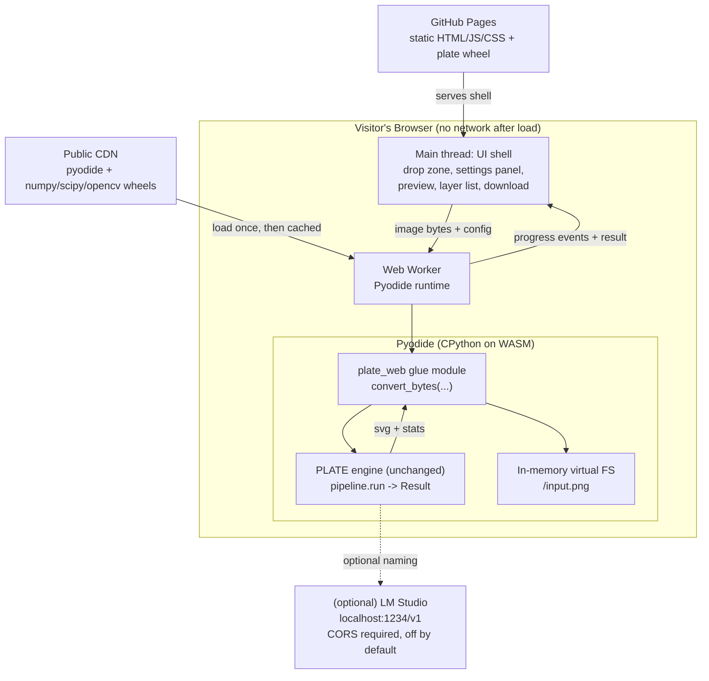
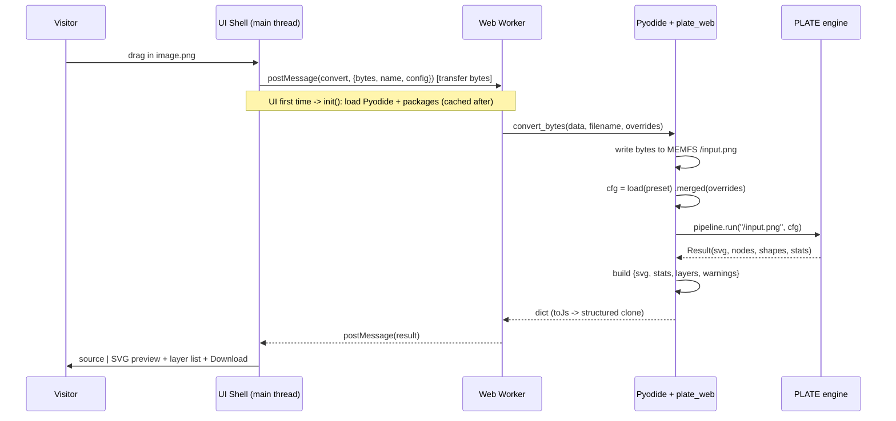

# Design Document: Browser Web Page (PLATE in the Browser)

## Overview

PLATE's conversion engine is a pure-Python pipeline (`numpy`, `scipy`, `opencv`, `pillow`) whose
single entry point is `pipeline.run(path, cfg, labels) -> Result`. This feature wraps that engine
in a free, static web page that runs the *unchanged* Python code in the visitor's browser via
Pyodide (CPython compiled to WebAssembly). A visitor drops in a PNG or JPG, picks a preset or
adjusts a few sliders, and downloads a named, layered, Illustrator-friendly SVG. No server, no
upload, no cost: the image never leaves the machine, GitHub Pages serves the static shell for
free, and browsers render the SVG preview natively.

The CLI remains the source of truth. The page is a thin shell around `pipeline.run`; it adds no
new conversion logic. Batch work and the optional LM Studio naming step stay with the CLI, though
the page exposes the same presets/levers and can optionally offer LM Studio naming for power
users (off by default, with a CORS caveat). The browser worker loads `numpy`, `scipy`,
`opencv-python`, `pillow` and `scikit-image` — the packages the engine imports when it loads
(`geometry.py` imports `skimage`), so the worker must load it too. The wheel is installed with
`deps=False` because the remaining Python-only extras have no Pyodide builds: `vtracer` and
`opencv-python-headless` (the headless build the CLI uses) are not available, and `cairosvg` /
`potrace` are used only for comparison, rendering and metrics and are **not** loaded in the
browser.

This design is deliberately **spike-gated**: Phase 1 is a measurement spike that must prove the
engine imports and runs in Pyodide, that OpenCV loads, and that the browser produces the same SVG
as the CLI within the bake-off's scoring tolerance. Nothing in Phases 2-4 should begin until the
spike answers whether PLATE runs acceptably in the browser. The four phases map directly onto the
brief's suggested path and sit on the roadmap between v0.2 (robust-on-real-files) and v0.3
(beyond-flat-colour).

## Architecture



The main thread owns the DOM and never blocks: all heavy work (Pyodide init, package loading,
conversion) happens in a Web Worker. The worker loads Pyodide and the scientific wheels from a
public CDN on first use, caches them in the browser for later visits, installs the PLATE wheel
(served from GitHub Pages alongside the shell), and exposes a single `convert_bytes` glue function.
The engine runs unchanged because the glue writes the uploaded bytes into Pyodide's in-memory
virtual filesystem and calls `pipeline.run("/input.<ext>", cfg)` — the engine still opens a "file"
exactly as on the CLI.

### Why Pyodide on GitHub Pages (alternatives considered)

| Option | Effort | Pros | Cons | Decision |
|---|---|---|---|---|
| **Pyodide on GitHub Pages** | Days | Reuses the Python engine as-is; one codebase; free static hosting; privacy by construction | Larger first download (tens of MB); slower than native | **Recommended** — chosen |
| Rewrite in Rust/TypeScript | Weeks | Small, fast, phone-friendly | A second codebase that drifts from the CLI | Only if the web page becomes the main product |
| `plate serve` local web page | Days | Native speed, same code | Visitor must still install PLATE | Rejected for a *public, zero-install* page |

### Deployment home (documented decision)

Default to a `/web` folder inside the PLATE repo (simplest; keeps the shell beside the engine so a
single GitHub Action can rebuild the wheel and redeploy on every engine change, so the web version
cannot lag the CLI). A separate repo is the alternative if the page later becomes the main product.
This is left as an explicit owner decision in the brief; the design assumes `/web` unless changed.

## Four-Phase Delivery Path (spike-gated)

Each phase ends in something checkable. Phases 2-4 are gated on Phase 1.

### Phase 1 — Spike (1-2 days) — GATE

Confirm the pipeline imports and runs in Pyodide, check OpenCV loads, and time it on the 24-scene
bake-off corpus.

- **Done-definition:** a PNG gives a byte-identical SVG in the browser and on the command line; a
  JPEG may differ from the CLI only because the browser's JPEG decoder produces different pixels,
  which is proven by running the unchanged engine on the exact browser-decoded pixels and getting
  the browser SVG back (byte-identical or within the bake-off's scoring tolerance, `bakeoff/score.py`
  composite).
- **Decision point:** if unworkably slow or OpenCV missing, stop and reconsider the alternatives
  (Rust/TS rewrite or `plate serve`). Record the outcome (timings per corpus scene, OpenCV load
  result, byte-level/score-level SVG diff vs CLI) in `STATUS.md`.

### Phase 2 — Minimal page

Upload → convert in a Web Worker → preview next to source → download SVG. No presets/sliders yet
beyond a single default; proves the end-to-end shell.

### Phase 3 — Automatic deploy

A GitHub Action builds the PLATE wheel and publishes `/web` to GitHub Pages whenever code changes,
so the web version cannot lag the CLI.

### Phase 4 — Polish

Presets and sliders mapped to `Config` levers, a noisy/JPEG-image warning, a before-and-after
view, and links to the CLI (for batch) and to LM Studio naming (for power users).

## Components and Interfaces

### Component 1: UI Shell (main thread)

**Purpose:** Own the DOM; collect the image and settings; show progress, preview, layer list, and
the download button. Never runs CPU-heavy work.

**Responsibilities:**
- Drag-and-drop / file-picker intake; validate type (PNG/JPG) and reject files above a size cap.
- Detect a heavily compressed / noisy JPEG and surface a beta warning *before* conversion.
- Render the settings panel (presets + a few sliders) and serialise it to a plain config object.
- Post `{imageBytes, filename, config}` to the worker; render progress events; show source vs SVG
  side by side with the layer list; wire the download button.

**Interface (TypeScript, main-thread side of the worker protocol):**
```typescript
interface PlateClient {
  init(): Promise<void>;                       // spin up worker, trigger Pyodide warm-up
  convert(input: ConvertRequest): Promise<ConvertResult>;
  onProgress(cb: (p: ProgressEvent) => void): void;
}

interface ConvertRequest {
  imageBytes: Uint8Array;    // raw file bytes, transferred (not copied) to the worker
  filename: string;          // e.g. "logo.png" — extension drives the VFS path
  config: PlateConfig;       // UI settings -> engine levers (subset of Config)
}

interface ConvertResult {
  svg: string;               // full SVG text, ready to download / preview
  stats: ConvertStats;       // objects, anchors, primitives, gradients, strokes, timings
  layers: LayerInfo[];       // top-level layer names/order for the layer list
  warnings: string[];        // e.g. "beta: compressed JPEG, hidden-object recovery limited"
}
```

### Component 2: Web Worker + Pyodide Runtime

**Purpose:** Host Pyodide off the main thread; load packages once; run the engine; stream progress.

**Responsibilities:**
- Lazily load Pyodide + `numpy`, `scipy`, `opencv-python` (Pyodide/micropip) from CDN; cache them.
- `micropip.install` the PLATE wheel served from GitHub Pages.
- Import the `plate_web` glue module and call `convert_bytes`.
- Post coarse progress events (load → install → import → segment → order → trace → emit).

**Interface (worker message protocol):**
```typescript
type WorkerIn =
  | { type: "init" }
  | { type: "convert"; id: string; request: ConvertRequest };

type WorkerOut =
  | { type: "ready" }
  | { type: "progress"; id?: string; stage: Stage; pct: number; note?: string }
  | { type: "result"; id: string; result: ConvertResult }
  | { type: "error"; id?: string; message: string; recoverable: boolean };

type Stage =
  | "load-pyodide" | "load-packages" | "install-plate" | "import"
  | "segment" | "order" | "trace" | "emit" | "done";
```

### Component 3: `plate_web` Python Glue Module

**Purpose:** The single bridge between JavaScript and the unchanged engine. Accepts raw bytes,
writes them into Pyodide's virtual filesystem, builds a `Config`, calls `pipeline.run`, and returns
a JSON-serialisable dict (SVG + stats + layer summary + warnings). This module lives in the engine
package (e.g. `src/plate/web.py`) so it ships in the same wheel and stays version-locked to the CLI.

**Why bytes → VFS → path:** `imageio.open_rgba` opens the input with *both* Pillow and
`cv2.imread(str(path))` (the latter for full-depth 16-bit PNG decoding). `cv2.imread` needs a real
filesystem path, not a Python buffer. Pyodide provides an in-memory FS (MEMFS), so writing the
bytes to `/input.<ext>` and passing that path lets `pipeline.run` and `imageio.load_image` work
**unchanged** — no engine edits, no fragile monkeypatching of the decoder.

**Interface:**
```python
def convert_bytes(
    data: bytes,                      # raw uploaded file bytes
    filename: str,                    # original name; extension selects the VFS path
    overrides: dict | None = None,    # UI settings: preset name + lever overrides
) -> dict:                            # JSON-safe: {"svg", "stats", "layers", "warnings"}
    ...

def check_noise(data: bytes, filename: str) -> dict:
    # Cheap pre-check (decode + resize + noise_fraction / interior_noise_fraction)
    # so the UI can warn about compressed JPEGs before a full conversion.
    ...
```

### Component 4: Settings Panel (presets + levers)

**Purpose:** Map a small, friendly UI onto the existing `Config` levers and `PRESETS`.

**Responsibilities:**
- Offer presets `logo`, `illustration`, `lineart`, `compact` (the brief's "logo, illustration,
  line art" plus compact) as the primary control.
- Expose a few sliders that map 1:1 onto `Config` fields (see Data Models below). Hidden/advanced
  levers keep their engine defaults.
- Keep LM Studio naming **off by default** behind an "advanced" toggle, with a CORS note.

### Component 5: GitHub Pages Deploy (GitHub Action)

**Purpose:** Rebuild the wheel and publish `/web` on every change so the browser cannot lag the CLI.

**Responsibilities:**
- Build the PLATE wheel (`python -m build`), copy it into the deploy artifact alongside the static
  shell, publish to GitHub Pages.
- Pin the Pyodide version and the scientific-package versions so a CDN change cannot silently break
  the page.

## Data Models

### Model: `PlateConfig` (UI → engine lever subset)

A plain object the UI produces and the glue maps onto `Config.merged(**overrides)`. Only a curated
subset is user-facing; everything else keeps engine defaults.

```typescript
interface PlateConfig {
  preset?: "logo" | "illustration" | "lineart" | "compact";
  // Friendly sliders, each 1:1 with a Config field:
  maxColors?: number;        // -> max_colors        (palette cap)
  simplify?: number;         // -> simplify          (curve fitting error, px)
  smooth?: number;           // -> smooth            (contour smoothing sigma, px)
  workSize?: number;         // -> work_size         (internal longest side)
  snapPrimitives?: boolean;  // -> snap_primitives   (circles/rects/polygons)
  strokes?: boolean;         // -> strokes           (open paths / thin loops)
  gradients?: boolean;       // -> gradients         (linear/radial fills)
  removeBackground?: boolean;// -> remove_background
  // Advanced, off by default:
  vlmUrl?: string;           // -> vlm_url  (LM Studio; CORS must be enabled)
  vlmModel?: string;         // -> vlm_model
}
```

**Validation rules:**
- `preset`, if present, must be a key of `PRESETS`; unknown presets are rejected by the glue.
- Numeric levers are clamped to engine-sane ranges before `Config.merged` (which itself rejects
  unknown keys via `KeyError`).
- `vlmUrl` stays empty unless the advanced toggle is on; an empty `vlm_url` disables naming.
- Load order mirrors the CLI: built-in defaults → preset → explicit overrides (no TOML in browser).

### Model: `ConvertStats`

Mirrors `Result.stats` so the UI can show object/anchor counts and timings (the timings also feed
the spike's performance measurement).

```typescript
interface ConvertStats {
  shapes: number;        // emitted leaf shapes
  completed: number;     // shapes with reconstructed hidden parts
  anchors: number;
  primitives: number;    // non-path elements (circle/ellipse/rect/polygon)
  gradients: number;
  strokes: number;
  tSegment: number; tOrder: number; tTrace: number; tTotal: number; // seconds
  vlmNames: number;
}
```

### Model: `LayerInfo`

```typescript
interface LayerInfo { name: string; kind: "layer" | "group" | "shape"; order: number; }
```

## Main Algorithm / Workflow



## Key Functions with Formal Specifications

### Function 1: `convert_bytes`

```python
def convert_bytes(data: bytes, filename: str, overrides: dict | None = None) -> dict
```

**Preconditions:**
- `data` is the raw bytes of a PNG or JPG the browser already accepted.
- `filename` is non-empty and carries a recognisable image extension; its extension (not its path)
  determines the MEMFS target `/input.<ext>` so the decoder picks the right format.
- `overrides`, if present, contains only keys the glue maps to valid `Config` fields (plus the
  optional `preset`).

**Postconditions:**
- Returns a JSON-serialisable dict `{"svg": str, "stats": dict, "layers": list, "warnings": list}`.
- `svg` is the exact text `emit.write_svg` produced — byte-identical to the CLI for the same input
  and config (this is the spike's correctness contract).
- No file persists after the call (the temporary MEMFS entry is removed in a `finally`).
- On a decode failure (`ImageLoadError`) the function raises a clean, message-bearing error the
  worker converts to a `recoverable` error event; the engine's own validation is not bypassed.

**Loop invariants:** N/A (no explicit loops; delegates to `pipeline.run`).

### Function 2: `check_noise`

```python
def check_noise(data: bytes, filename: str) -> dict
```

**Preconditions:** same intake contract as `convert_bytes`.

**Postconditions:**
- Returns `{"noisy": bool, "jpeg": bool, "noise_fraction": float, "interior_noise": float}`.
- `noisy` is true iff `noise_fraction > 0.04` or `interior_noise_fraction > Config.interior_noise`,
  matching the engine's own auto-denoise trigger in `imageio.load_image` (so the warning reflects
  what the engine will actually do, rather than a second, divergent heuristic).
- No side effects; no persisted file.

**Loop invariants:** N/A.

### Function 3: `build_config` (glue helper)

```python
def build_config(overrides: dict | None) -> Config
```

**Preconditions:** `overrides` is `None` or a dict whose keys are the UI lever names.

**Postconditions:**
- Returns a frozen `Config` equal to `config.load(preset).merged(**clamped_levers)`.
- Rejects an unknown preset or unknown lever key with a descriptive error (reusing
  `Config.merged`'s `KeyError` for unknown fields rather than silently ignoring them).
- Never enables LM Studio naming unless `vlmUrl` is a non-empty string.

**Loop invariants:** iterating the override map, every processed key has been validated and clamped,
and no invalid key reaches `Config.merged`.

## Algorithmic Pseudocode

### Glue: convert one image

```python
# plate_web.convert_bytes — the whole browser-to-engine bridge.
def convert_bytes(data: bytes, filename: str, overrides: dict | None = None) -> dict:
    assert data, "empty file"
    ext = extension_of(filename) or "png"          # precondition: known image ext
    path = f"/input.{ext}"                          # MEMFS path cv2.imread can open

    cfg = build_config(overrides)                   # defaults -> preset -> clamped levers
    warnings = []
    noise = _noise_report(data, filename)           # reuse engine estimators
    if noise["jpeg"] and noise["noisy"]:
        warnings.append(BETA_JPEG_WARNING)          # hidden-object recovery limited today

    try:
        write_file(path, data)                      # bytes -> Pyodide virtual FS
        result = pipeline.run(path, cfg)            # UNCHANGED engine entry point
    finally:
        remove_file_if_exists(path)                 # no image persists in memory FS

    layers = summarise_top_level(result.nodes)      # names/order for the UI layer list
    return {
        "svg": result.svg,
        "stats": camel_or_snake(result.stats),
        "layers": layers,
        "warnings": warnings,
    }
```

**Preconditions:** `data` are accepted image bytes; `filename` has an image extension.
**Postconditions:** returns `{svg, stats, layers, warnings}`; MEMFS is clean; engine ran unchanged.
**Loop invariants:** N/A.

### Worker: lazy runtime bring-up (JavaScript, structured pseudocode)

```pascal
PROCEDURE ensureRuntime()
  INPUT: none (uses module-level cached handle)
  OUTPUT: a ready Pyodide handle

  SEQUENCE
    IF runtime IS ready THEN
      RETURN runtime
    END IF

    emitProgress("load-pyodide", 0)
    runtime <- loadPyodide(fromPinnedCDN)        // cached by browser after first load

    emitProgress("load-packages", 25)
    loadPackages(runtime, ["numpy", "scipy", "opencv-python"])

    emitProgress("install-plate", 70)
    micropipInstall(runtime, PLATE_WHEEL_URL)    // served from GitHub Pages

    emitProgress("import", 90)
    runtime.runPython("import plate.web as plate_web")

    emitProgress("done", 100)
    RETURN runtime
  END SEQUENCE
END PROCEDURE

PROCEDURE handleConvert(request)
  INPUT: request (imageBytes, filename, config)
  OUTPUT: posts a result OR error message to the main thread

  SEQUENCE
    rt <- ensureRuntime()
    TRY
      resultObj <- rt.callPython("plate_web.convert_bytes",
                                 request.imageBytes, request.filename, request.config)
      postMessage({ type: "result", id: request.id, result: toJs(resultObj) })
    CATCH err
      postMessage({ type: "error", id: request.id,
                    message: readableMessage(err), recoverable: isDecodeError(err) })
    END TRY
  END SEQUENCE
END PROCEDURE
```

**Preconditions:** the worker was created by the UI; `request.imageBytes` is a transferable buffer.
**Postconditions:** exactly one `result` or `error` message is posted for `request.id`; the runtime
stays warm for subsequent conversions.
**Loop invariants:** N/A.

## Example Usage

### Browser main thread (TypeScript)

```typescript
const client = createPlateClient();            // wraps the Web Worker
client.onProgress(p => progressBar.set(p.stage, p.pct));

async function onDrop(file: File) {
  const bytes = new Uint8Array(await file.arrayBuffer());
  const config: PlateConfig = { preset: "logo", maxColors: 8 };
  const { svg, stats, layers, warnings } = await client.convert({
    imageBytes: bytes, filename: file.name, config,
  });
  showSourceAndSvg(file, svg);                 // side-by-side preview
  renderLayerList(layers);
  warnings.forEach(showBanner);                // e.g. compressed-JPEG beta notice
  downloadButton.onclick = () => saveText(svg, replaceExt(file.name, ".svg"));
}
```

### Python glue (what actually runs in Pyodide)

```python
import plate.web as plate_web

# bytes come across the worker boundary as a JS Uint8Array -> Python bytes
out = plate_web.convert_bytes(image_bytes, "logo.png", {"preset": "logo", "max_colors": 8})
assert out["svg"].startswith("<?xml") or out["svg"].lstrip().startswith("<svg")
assert out["stats"]["shapes"] >= 1
```

### Spike equivalence check (CLI vs browser)

```python
# Phase-1 done-definition, run against the 24-scene bake-off corpus.
cli = pipeline.run("samples/badge.png", Config()).svg
web = plate_web.convert_bytes(open("samples/badge.png", "rb").read(), "badge.png")["svg"]
assert cli == web                               # byte-identical target
# If not byte-identical (platform float drift), fall back to the bake-off score tolerance:
# score(web_svg) within composite tolerance of score(cli_svg)  (bakeoff/score.py)
```

## Correctness Properties

### Property 1: Thin shell / source of truth

For every PNG and config, the SVG returned by `convert_bytes` equals the SVG `pipeline.run` returns
on the CLI for the same image and config, byte-identical. For a JPEG, the SVG may differ from the
CLI only because the browser's JPEG decoder produces different pixels: the engine run on the exact
browser-decoded pixels reproduces the browser SVG (byte-identical target; bake-off score tolerance
as the documented fallback). The page adds no conversion logic.

`∀ png, cfg : convert_bytes(bytes(png), name, overrides(cfg)).svg == pipeline.run(path(png), cfg).svg`
`∀ jpeg, cfg : convert_bytes_on(browser_pixels(jpeg), cfg).svg == browser_svg(jpeg, cfg)`

### Property 2: Privacy by construction

`convert_bytes` performs no network I/O for the core path; the image bytes exist only in the worker
and MEMFS and are removed after the call. The only outbound request is the optional,
explicitly-enabled LM Studio call.

`∀ image : network_requests(convert_bytes(bytes(image), name, {})) == ∅`

### Property 3: Config fidelity

`build_config(overrides)` yields the same `Config` the CLI would build for the equivalent
`--preset` / `--set` flags; unknown presets/levers are rejected, not ignored.

`∀ valid_overrides : build_config(valid_overrides) == load(preset).merged(**levers)` and
`∀ invalid_key ∈ overrides : build_config(overrides) raises`

### Property 4: Warning matches behaviour

`check_noise` reports `noisy` iff the engine's auto-denoise would fire (the `imageio.load_image`
trigger), so the UI never warns about an image the engine treats as clean, nor stays silent on one
it denoises.

`∀ image : check_noise(image).noisy ⟺ (noise_fraction(image) > 0.04 ∨ interior_noise_fraction(image) > interior_noise)`

### Property 5: Non-blocking main thread

No conversion runs on the main thread; the UI thread only posts/receives messages, so the page stays
responsive (addresses the WASM-speed risk perceptually).

`∀ conversion : runs_on(conversion) == WebWorker ∧ main_thread_work(conversion) == message_passing_only`

### Property 6: Memory bounded

The work-size cap (`Config.work_size`, default 1536) applies in the browser exactly as on the CLI;
files above a hard byte/dimension cap are rejected before decode.

`∀ image : longest_side(internal(image)) ≤ work_size ∧ (bytes(image) > cap ⟹ rejected_before_decode)`

## Error Handling

### Scenario: OpenCV (or another wheel) fails to load in Pyodide
**Condition:** `loadPackages`/`micropip.install` cannot resolve a Pyodide build (the brief's top
unverified risk). **Response:** the worker posts a non-recoverable `error` with a clear message; the
UI shows a "not supported in this browser yet" notice. **Recovery:** Phase-1 spike mitigation — check
first; fall back to a smaller OpenCV call set or a different build; if truly missing, the spike's
decision point routes to an alternative (Rust/TS rewrite or `plate serve`). This risk gates Phase 2.

### Scenario: Conversion is too slow in WebAssembly
**Condition:** per-image time on the corpus is unacceptably high. **Response:** progress bar + Web
Worker keep the page responsive; the spike records per-scene timings in `STATUS.md`. **Recovery:**
reduce `work_size`, cache the warm runtime, and if still unworkable, hit the spike decision point.

### Scenario: First-load download is large (tens of MB)
**Condition:** Pyodide + scientific wheels on first visit. **Response:** load from CDN with a clear
staged progress bar (`load-pyodide` → `load-packages` → `install-plate`). **Recovery:** browser cache
makes later visits fast; versions are pinned so caches stay valid.

### Scenario: Compressed / noisy JPEG
**Condition:** `check_noise` flags a noisy JPEG; the engine recovers 0/10 hidden objects on heavily
compressed JPEGs today. **Response:** a beta warning banner before/at conversion. **Recovery:**
label the page beta; defer full JPEG robustness to the v0.2 work; conversion still runs and still
downloads a usable SVG.

### Scenario: Image too large for browser memory
**Condition:** an enormous upload. **Response:** reject files above a byte/dimension cap *before*
decode; keep the work-size cap for everything accepted. **Recovery:** the user downsizes and retries.

### Scenario: Unreadable / unsupported file
**Condition:** `imageio.open_rgba` raises `ImageLoadError`. **Response:** the glue lets it raise; the
worker posts a `recoverable` error with the engine's own message. **Recovery:** user picks another
file; engine validation is never bypassed.

### Scenario: LM Studio naming requested but CORS not enabled
**Condition:** advanced naming toggle on, but the local LM Studio server rejects the browser origin.
**Response:** the naming call fails gracefully; classical color+shape names are used (the engine's
default `name_layers` path), and a note explains enabling CORS in LM Studio. **Recovery:** naming is
optional and off by default, so the core result is unaffected.

### Scenario: Safari / WebAssembly quirks
**Condition:** Safari is the least predictable WASM target (and for local LM Studio). **Response:**
test Chrome/Edge/Firefox first; feature-detect and show a compatibility notice on Safari until
verified. **Recovery:** the page degrades to an explicit "best in Chrome/Edge/Firefox" message.

## Testing Strategy

### Unit testing
- `plate.web.build_config`: preset + lever mapping equals the CLI's resolved `Config`; unknown keys
  rejected; clamping; LM Studio stays off unless `vlm_url` set. Pure Python, runs under `pytest`.
- `plate.web.check_noise`: agrees with `imageio.load_image`'s auto-denoise trigger on clean art and
  on the noisy samples already in the suite.
- `plate.web.convert_bytes`: round-trips the existing `samples/*.png` by reading the file bytes and
  asserting the SVG equals `pipeline.run(path).svg` — the CLI-equivalence contract, testable in
  plain CPython without a browser.

### Property-based testing
- **Property-test library:** `hypothesis` (the project is Python; matches the existing stack).
- **P1 equivalence:** for images drawn from the sample/corpus set and configs drawn from valid
  preset+lever combinations, `convert_bytes(...).svg == pipeline.run(...).svg`.
- **P3 config fidelity:** for arbitrary valid override maps, `build_config(overrides)` equals the
  CLI's `load(...).merged(...)`; arbitrary invalid keys always raise.
- **P2 no-persist:** after any `convert_bytes` call (success or `ImageLoadError`), no MEMFS input
  file remains (checked with a fake/temp filesystem in the CPython test).

### Integration / browser testing
- A headless-browser smoke test (Phase 2+) that loads the page, drops a fixed sample, and asserts
  the downloaded SVG matches the CLI output within the bake-off tolerance. This is the automated
  form of the spike done-definition and guards against the web shell drifting from the CLI.
- Manual matrix: Chrome, Edge, Firefox first; Safari flagged until verified (per the Safari risk).

## Performance Considerations

- **First load:** tens of MB (Pyodide + numpy/scipy/opencv). Mitigated by CDN delivery, staged
  progress, and browser caching; versions pinned so caches remain valid.
- **Conversion speed:** native runs are sub-second on small images; WASM is unmeasured and expected
  slower. The spike measures per-scene time on the 24-scene corpus and records it in `STATUS.md`.
  A warm, reused Pyodide runtime avoids re-initialisation per conversion.
- **Memory:** the `work_size` cap (default 1536) bounds engine memory exactly as on the CLI; a hard
  upload byte/dimension cap prevents decode-time blowups.
- **Responsiveness:** all heavy work is off-main-thread in the Web Worker, with coarse progress
  events per pipeline stage.

## Security & Privacy Considerations

- **Privacy by construction:** the image never leaves the device; the core path makes no network
  requests. This matches Digital Defiance's privacy-first stance.
- **No server attack surface:** static hosting only; nothing to abuse, scale, or defend.
- **Untrusted input:** all decoding goes through the engine's existing `open_rgba`, which already
  guards against decompression bombs and malformed streams and raises `ImageLoadError`; the glue
  adds a pre-decode byte/dimension cap.
- **Optional LM Studio naming:** off by default; when enabled it talks only to the user's own
  `localhost:1234/v1` and requires the user to enable CORS in LM Studio. No third-party endpoint is
  ever contacted with image data.
- **Pinned dependencies:** Pyodide and wheel versions are pinned to avoid a CDN change silently
  altering behaviour or correctness.

## Dependencies

- **Browser-side engine deps (must have Pyodide/WASM builds):** `numpy`, `scipy`,
  `opencv-python`, `pillow` and `scikit-image` — the packages the worker loads, which are exactly
  what the engine imports when it loads (`geometry.py` imports `skimage`). OpenCV availability is
  the top unverified risk and is the spike's first check.
- **Runtime host:** Pyodide (pinned version) from a public CDN; `micropip` for installing the PLATE
  wheel with `deps=False` (because `vtracer` and `opencv-python-headless` have no Pyodide builds,
  so the wheel's own dependency list cannot be resolved in the browser).
- **Explicitly NOT loaded in the browser:** `vtracer`, `cairosvg`, `potrace`
  (comparison / rendering / metrics only — the browser previews SVG natively).
- **Shell:** static HTML/CSS/JS (or TS compiled to JS); a Web Worker; no framework required.
- **Deploy:** a GitHub Action building the PLATE wheel and publishing `/web` to GitHub Pages on
  every change (keeps the page from lagging the CLI).
- **New engine code:** a small `plate.web` glue module (`convert_bytes`, `check_noise`,
  `build_config`) shipped inside the existing wheel so it stays version-locked to `pipeline.run`.

## Open Decisions (from the brief, for the owner)

These are surfaced here but not resolved by the design; they feed the requirements/tasks phases:
- Approve the spike (1-2 days) and add the web page to README and ROADMAP as a goal between v0.2
  and v0.3.
- Launch as beta before JPEG robustness work, or wait for v0.2?
- Home: `/web` folder in the PLATE repo (assumed default) or a separate repo.
- Show links to the CLI and to LM Studio naming for power users?
