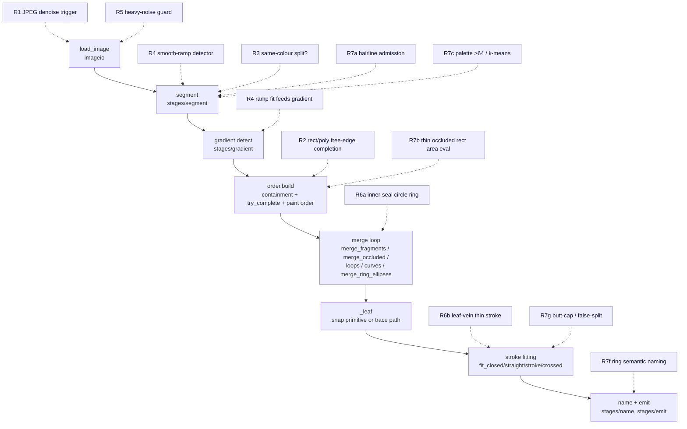

# Design — PLATE Engine Completion

This document encodes *how* the requirements in `requirements.md` are driven to their two
terminal states. It is grounded in the real code at `main @ 425fa19`. It restates the
architecture the changes slot into, defines the measure-first methodology every item
follows, gives an actual algorithm sketch for each requirement expected to produce a FIX,
names the exact pipeline stage and lever each item touches, spells out the testing and
edge-case handling, explains how each class of change preserves the regression surface, and
discusses the honest ceiling. A competent engineer should be able to implement each task in
`tasks.md` from this document without re-deriving the approach.

It is **not** a redesign of PLATE's architecture — the pipeline is settled (`AGENTS.md`;
`docs/SPEC.md` is the older aspirational spec, superseded in parts by what `pipeline.run`
actually does, which is the authority restated below).

---

## 1. System architecture (what the changes slot into)

PLATE converts a raster image into an Illustrator-friendly layered SVG with one classical,
CPU-only, deterministic pipeline. The orchestration is `pipeline.run(path, cfg, labels)` in
`src/plate/pipeline.py`; it returns a `Result` and never calls the VLM for geometry (GC-2).
Every requirement in this spec intervenes at one named boundary of this pipeline.

### 1.1 Stage-by-stage dataflow

`run()` executes these stages in order (file references are `src/plate/`):

1. **load** (`imageio.load_image` → `Loaded`). `open_rgba` decodes any Pillow-readable image
   to 8-bit RGBA in display orientation (EXIF applied, 16-bit PNG handled at full sample
   depth). The image is resized so the longest side ≤ `cfg.work_size` (`scale = work_px /
   source_px`). An **auto-denoise** branch then fires at most `level` bilateral passes when
   `cfg.denoise < 0` and the input reads noisy — the OR of `noise_fraction(rgb,alpha) > 0.04`
   (global median-residual share) and `interior_noise_fraction(rgb,alpha) > cfg.interior_noise`
   (the same test restricted to edge-free interiors, catching mild uniform noise the global
   estimator's edge-density confound masks). **(R1, R5 intervene here.)**

2. **segment** (`stages/segment.segment` → `Segmentation`). Classical flat-art segmentation:
   find flat (non-edge) pixels via a Sobel gradient threshold (`cfg.edge_threshold`); build a
   palette from them in `_build_palette` (count-floor `counts >= max(2, 0.0004·len(px))`, then
   `color_merge` Lab-dE dedup, then a flat-palette ceiling or k-means fallback); extend the
   palette from stable pre-dilation colour cores and from isolated-alpha components within the
   `max_colors`/`FLAT_PALETTE_CEILING` budget; assign every edge pixel to the nearest palette
   colour (or a two-colour coverage blend) in `_edge_labels`; clean specks; split each label
   into 4-connected regions, one `Shape` per region (`Shape.vis == Shape.full` at this point).
   **(R3, R4, R7a, R7c intervene here.)**

3. **gradient.detect** (`stages/gradient.detect`, when `cfg.gradients`). Finds maximal sets of
   adjacent *thin flat bands* that together form one smooth linear/radial ramp, replaces each
   confident set with a single `Shape` carrying a `GradientFill`, and returns a **re-indexed**
   `Segmentation` (`id == index`, rebuilt `rid`, palette unchanged). Gated by `grad_min_bands`,
   `grad_max_residual`, `grad_band_max_frac`, `grad_min_frac`, `grad_step_de`, `_single_object`,
   `_monotone_ok`. **(R4 intervenes here.)**

4. **order.build** (`stages/order.build`). Computes `Shape.sil` (hole-filled visible
   silhouette), assigns the containment tree (`parent` = smallest silhouette that contains a
   shape; children list = paint order bottom→top), and for touching siblings calls
   `complete.try_complete` to reconstruct hidden parts and establish occluder edges, then
   topologically sorts each sibling set. It also computes `Shape.draw` (= `full` + a restricted
   1px `bleed` only where a later neighbour covers the shape, so no hairline seams show).
   **(R2 and R7b intervene inside the completion call here.)**

5. **completion / fragment-merge loop** (in `run()`, `while cfg.complete_hidden`). Repeatedly
   applies `order.merge_fragments` (parent-island redundancy, same-colour flat-pool completion,
   and `_merge_compound_siblings` for interrupted same-colour compounds — the circle arm) and,
   when nothing merges, `gradient.merge_occluded` (reunite two independently-completed gradient
   primitives, or `_grow_radial_bands` around a radial seed). Then, when `cfg.strokes`, the loop
   recovers closed loops (`stages/loops.recover`), open curves (`stages/curves.recover`), and
   reunites interrupted **elliptical** rings (`order.merge_ring_ellipses` → `_fit_ring_ellipse`,
   producing a `Shape.closed_stroke`). Each merge rebuilds the order. **(R6a intervenes in
   `_merge_compound_siblings`'s circle arm here.)**

6. **leaves** (`pipeline._leaf` per shape). Turns each `Shape` into a `Node`: a snapped
   primitive from `Shape.prim`/`primitives.snap`/`snap_ring` when `cfg.snap_primitives`, else a
   traced path from `Shape.draw` via `stages/trace.mask_to_path` (sub-pixel contours, corner
   detection, Schneider Bézier fit in `bezier.py`). A `GradientFill` is converted to SVG coords
   and attached. Translucent shapes get a source-`opacity`.

7. **stroke fitting** (in `run()`, when `cfg.strokes`). Replaces eligible filled leaves with
   constant-width stroke nodes: `stages/strokes.fit_closed` (thin circular/elliptical loop),
   `fit_straight` (round-capped line with ≥1 visible cap, competing against a butt-capped
   rectangle), `fit_stroke` (open round-cap/join curve; floors `width >= 2`,
   `mask.area >= 24·radius²`), `fit_crossed_curve` (curve under overlays). Paint-order edges are
   re-sorted when a stroke continues under a later hub. **(R6b and R7g intervene here.)**

8. **name + emit** (`stages/name`, `stages/emit.write_svg`). Classical `"{colour} {word}"`
   base names, then optional VLM semantic names/groups (cosmetic only), then the SVG is
   written. Top-level groups become Illustrator layers (Adobe `i:layer` + Inkscape markers).
   **(R7f intervenes in `name.py`.)**

### 1.2 Key data structures

- **`Shape`** (`scene.py`). `vis` = pixels the shape visibly owns; `full` = complete
  hole-filled/amodal silhouette after completion; `sil` = hole-filled *visible* silhouette
  before completion; `draw` = what actually gets traced (`full` + restricted bleed). The three
  masks matter because **primitives are snapped from `full`** (the reconstructed whole), while
  **paths are traced from `draw`** (visible + seam bleed, never the invented interior) — so a
  completed occluded rectangle emits as a clean `<rect>` yet a non-completable shape still
  traces only what the raster shows. `prim`/`verified_prim` carry an exact primitive from
  completion; `grad` carries a `GradientFill`; `closed_stroke` carries a reunited elliptical
  ring's native stroke. `parent`/`children` encode the tree and paint order.
- **`Segmentation`** (`scene.py`). `rid` (H×W int32 region map, −1 = transparent), `shapes`,
  `palette`. `Segmentation.rebuilt(shapes)` **re-indexes** survivors to `id == index`, rebuilds
  `rid`, and *discards* stale tree/completion fields — and asserts visible ownership is
  unchanged (`rid >= 0` identical). Every merge path returns through `rebuilt`/`_reindex`, which
  is what makes the additive paths provably non-destructive to visible pixels.
- **`Config`** (`config.py`). A **frozen** dataclass that is the single source of all levers;
  every field maps 1:1 to a CLI flag and a TOML key. `load()` precedence is built-in defaults →
  `--preset` (`PRESETS`) → `--config` TOML → CLI flags (later wins). `Config.merged(**overrides)`
  validates keys. The gates this spec must not weaken (`color_merge`, `snap_tolerance`, the
  stroke width/area floors, the 15° `_occludes` threshold, the `grad_*` gates, the completion
  tolerance) all live here or are derived from these fields.
- **`Result`** (`pipeline.py`). `svg`, `nodes` (the emitted tree), `shapes`, `seg`, `loaded`,
  `cfg`, `stats` (shape/primitive/gradient/stroke counts and per-stage timings). Diagnostics and
  tests read `Result` to assert object-level outcomes.
- **`Node`** (`scene.py`). The output tree node in **SVG coordinates** (group/path/circle/
  ellipse/rect/polygon), with `grad`, `stroke_width`, `opacity`.

### 1.3 Coordinate convention (GC-3)

Internal coordinates are **pixel-centre** (pixel `i` sits at integer `i`), matching
`skimage.measure.find_contours` and OpenCV's sub-pixel drawing (`SHIFT=4`,
`SCALE=16`). The emitter maps a working-pixel position to SVG by `P(v) = (v + 0.5)/scale`
and a length by `S(v) = v/scale`, where `scale = work_px/source_px`. `_convert_grad` maps
gradient geometry the same way. No change in this spec may break this mapping.

### 1.4 Where each requirement intervenes



(R7d soft alpha touches the `segment`/opacity path at B/F; R7e scale touches `work_size`
behaviour spanning A/B/C. R8 is an audit over the whole diagram, not a stage change.)

---

## 2. The measure-first methodology

Every requirement follows the same four-step loop, which is the established practice in
this project (the five investigation reports under `.agents/tasks/*investigation*.md` are
the precedent and template):

1. **MEASURE.** Reproduce and quantify the gap with the trustworthy diagnostic for its
   class, before touching any code:
   - per-object structural targets →
     `DYLD_FALLBACK_LIBRARY_PATH=/opt/homebrew/lib PYTHONPATH=tests .venv/bin/python -m challenge_report <name>`
     (surfaces missing / extra / split / merged, silhouette IoU, topology, primitive/fill,
     paint order);
   - objective cross-tool scoring → `plate corpus -o <dir> -n 24 --seed 1` then
     `plate bakeoff <dir>/images --truth <dir>/truth -o <out>` (`docs/BAKEOFF.md`;
     metrics incl. `hidden_completion`, `obj_complete_f1`);
   - robustness → `python -m plate.robustness --output <dir>` (`--suite core` for the
     passing subset; the full run intentionally exits 1 while misses remain);
   - real-world messy inputs → `plate bench samples/real` (`docs/REAL-CORPUS.md`).

2. **INVESTIGATE (read-only).** Classify each sub-gap **FIXABLE** vs **LIMIT** with pixel
   evidence, writing throwaway probes that only read the repo. Walk the pipeline link by
   link to find the *first* stage that diverges (the JPEG report's clean-vs-jpg link walk
   is the model). A gap is a LIMIT only when the evidence shows no classical cue exists —
   the boundary is absent from every channel (colour, luminance, alpha, silhouette
   concavity), so recovering it would invent geometry or need an ML model.

3. **ACT.** Either:
   - a **scoped fix** in a git worktree, run through an implement-and-review loop, that
     moves the measured number and adds a regression test pinning it (state (a)); or
   - a **pin test** documenting the limit with the measured raster fact, so it cannot
     drift or be falsely "fixed" by weakening a gate (state (b)).

4. **VERIFY.** Re-run the whole regression surface (§6) and confirm it holds, plus the
   item's own diagnostic moved as claimed.

A fix that cannot move its number without weakening a gate, editing a target, or inventing
geometry is **not** a fix — it converts to a documented limit. That is the discipline that
keeps "done" honest.

---

## 3. Per-requirement algorithm design (the FIX items)

Each sketch below gives the inputs, the decision/computation, the accept/reject criteria,
and the exact gate values reused — grounded in the investigation measurements. Items
expected to resolve as a LIMIT are sketched more briefly (hypothesis + likely terminal
state + the cue that *would* be investigated).

### 3.1 R1 — JPEG robustness (FIX, format-keyed denoise trigger)

**Where.** `imageio.load_image`, inside the `level < 0` auto-denoise branch. `open_rgba`
already decodes with Pillow, so the decoded source format is known as `im.format` — but
`load_image` currently only sees the numpy arrays. The fix threads the format through: have
`open_rgba` (or a small sibling) expose whether the decoded source was `im.format == 'JPEG'`,
and pass that into `load_image`'s denoise decision.

**Decision logic.** When the decoded source is JPEG, force exactly **one** fixed bilateral
pass (the existing `cv2.bilateralFilter(rgb, 9, 40, 5)` kernel, `level = 1`) regardless of the
`noise_fraction`/`interior_noise_fraction` estimators, which the JPEG investigation measured
are blind to JPEG-q55 ringing (`noise_fraction` 0.011–0.026, below the 0.04 gate; interior
≈ 0, below the 0.002 lever). The trigger is OR-ed with the existing estimator branch so a JPEG
that *also* reads noisy by the estimators is unaffected.

**Why one pass, measured.** Denoise is non-monotonic: `denoise=1` on the JPEG scenes took
aggregate `hidden_completion` 0.30 → 0.40 (scene03 recovers its occluded rect: `fit_rect` RMS
drops back below `try_complete`'s tolerance once ringing stops displacing the segmentation
boundary), while `denoise=2` *over-rounds* scene03's corners and loses that recovery. So the
trigger uses one pass, not the scaling `level` loop.

**Why byte-safe by construction (GC-4).** Every shipped sample and challenge is PNG; a trigger
keyed on `im.format == 'JPEG'` fires on **no PNG**, so the 24 shipped SVGs are byte-identical
by construction and the PNG robustness sweep is untouched — not by luck, by the keying. This is
preferred over lowering the `noise_fraction` gate precisely because the clean shipped logos
score *higher* `noise_fraction` than every JPEG scene (edge-density confound), so any global
threshold catching JPEG re-denoises ≥10 shipped SVGs.

**DCT-grid fallback.** The format trigger keys on the container, so a clean photo-sourced JPEG
would also get one bilateral pass. One pass of `bilateralFilter(9,40,5)` is gentle, but before
committing, measure SSIM on a clean JPEG. If that single pass is unacceptable, gate the trigger
behind a DCT-domain estimate (8×8 quantization-grid energy / quantization-table presence)
rather than the spatial 8×8-block metric, which the investigation measured is *not* separable
on this flat-art corpus (clean `scene04`/`shaded` land inside the JPEG block-roughness range).

**Residual (→ R1 state (b)).** The 3 objects in scene15 (×2) and scene23 (×1) recover 0 even
on the clean render at every denoise level — a pre-existing rect/polygon completion limit (the
R2 class), not a JPEG bug. Pin the clean-render floor (§5) so they are never re-chased.

**Docs.** This requirement also corrects `docs/BAKEOFF.md`: replace the 0/10 figure and the
T-junction attribution with the measured 3/10 and the `complete.try_complete` primitive-fit
cause (the occlusion/T-junction test is exonerated — it finds the junctions and scores the
occluder correctly on JPEG input).

### 3.2 R2 — Rect / polygon amodal completion by free-edge intersection (FIX)

**Where.** `stages/complete.try_complete` / its `evaluate` closure. Today, after the relative
T-junction test selects the real occluders and splits the external contour into
`free`/`occluded`/`frame` points, completion fits exact primitives to the **free points only**:
`fit_circle`, then `fit_ellipse`, then `fit_rect` (`geometry.py`), each accepted by RMS ≤ `tol`
(`tol = max(0.9, 1.5·snap_tolerance·√area)`). For a partly-hidden rectilinear shape whose hidden
**corner** is behind the occluder, the free points are two or more straight edge segments that
do not themselves determine the corner, so `fit_rect`'s `minAreaRect` seed is biased by the cut
and its RMS exceeds `tol` — the measured scene03/scene15/scene23 failure (clean rect RMS past
tol; and the JPEG case where ringing pushes it further).

**Algorithm.** Add a free-edge **line-intersection** reconstruction as a candidate *before*
the existing `evaluate` of a rect/polygon fit:

1. Partition the `free` contour points into near-straight runs (the shape is rectilinear): walk
   the resampled free contour, break runs where the local turning angle (reuse the tangent
   machinery already in `complete.py`: `_side_tangent` / `_turn_at`) exceeds a corner threshold.
   Keep only runs long enough to fit a stable line (guard against short/ambiguous edges — see
   §4). Each run is a *free edge*.
2. Fit a line (total-least-squares / `np.polyfit` on the dominant axis) to each free edge.
3. For each pair of **adjacent** free edges whose lines are non-parallel, intersect them to
   reconstruct the hidden corner vertex. Chain the free edges and the reconstructed corner(s)
   into a closed polygon (for a rect, the 4th corner is the intersection of the two extended
   free edges; for a convex polygon, extend and intersect successive free edges across each
   occluded gap).
4. Rasterise the reconstructed polygon (`geometry.raster_prim` on a `Prim('polygon', ...)` /
   `fit_rect` re-fit of the completed vertex set to recover a clean axis-aligned `rect`/`rrect`
   where applicable) and feed it to the **existing** `evaluate`.

**Accept/reject (unchanged gates).** The reconstructed silhouette must pass `evaluate` exactly
as today: it must still contain the observation (`(Rm & ~P).sum() <= 0.03·area`), add at least
`min_extra` pixels, and the added ("extra") region must lie under the occluders
(`cm_floor`/`cv_floor` coverage of `Cm`/`Cv`) and overlap each claimed occluder by ≥
`max(6, 0.08·ne)`. The primitive-fit RMS gate and the 15° `_occludes` threshold are **not**
loosened — line intersection is a *new way to propose* a candidate that the same tolerance then
judges, which is why this is additive, not a gate relaxation.

**Expected number.** Raise overall bake-off `hidden_completion` toward ≥ 0.8 with occluded
rect/polygon/rrect per-kind counts (baseline rect 4/11, polygon 3/10, rrect 5/12) measurably up.

**Residual (→ state (b)).** When free edges are too short or too occluded to determine a unique
intersection (ambiguous), fall back to current behaviour and pin the measured free-edge pixel
extent vs the ambiguity threshold.

### 3.3 R4 — Smooth single-ramp region detector (FIX)

**Where.** A new pre-pass in `stages/segment.segment` (or feeding `stages/gradient.detect`
before `_find_components`). The orb is lost **upstream of every gradient gate**: `_build_palette`
collapses `real_radial_orb` to 1 palette colour (the smooth ramp spreads over 29 617 unique
colours, none repeating ≥ the count floor of 79, so only the near-white background cluster
survives and `color_merge` dedups it to one swatch), `segment()` emits 1 full-canvas region,
and `gradient.detect` receives **zero band candidates**. The affine radial fitter itself already
accepts the orb's falloff when given its pixels — the missing piece is candidate formation
*without posterized bands*.

**Detection signature (measured on the orb).** Before per-region emission, scan each
4-connected opaque component and admit it as a ramp candidate when all hold:

- **one 4-connected opaque component** (a single blob, not a textured field);
- **high luma span** across the blob (orb L/luma span ≈ 244.8 — nearly the full range);
- **LOW local Lab-gradient median** (orb interior Lab-gradient median ≈ 6.64; a small
  threshold ~8 means *smooth*, not noisy/textured — this is what distinguishes the orb from
  sensor noise, whose local gradient is high);
- **high unique-colour mass with ~no repeated-colour mass** (orb 29 617 unique colours,
  essentially none repeating — exactly the signature that defeats the count-floor palette).

**Fit and accept.** Feed the candidate blob's **raw region pixels** (not posterized bands) to
the existing `geometry.fit_radial_gradient` / `fit_linear_gradient`, choosing the lower-residual
model (ties → linear). **Accept only** at residual ≤ `cfg.grad_max_residual` (the orb's radial
fit is well under 0.06). On accept, emit **one** `Shape` carrying the `GradientFill` and **skip
adding the ramp's colours to the flat palette** (so segmentation does not also shatter it into
bands). On reject, the blob flows unchanged into the normal palette/edge-assignment path.

**Why additive by construction (GC-4).** Flat art and the control fixtures still flow the
unchanged band path: they **posterize** into repeated-colour bands (so they never look like a
single high-unique-colour smooth blob) and they **fail the smoothness test** (flat art has near-
zero interior Lab gradient between bands but is not one smooth ramp — it has discrete steps, so
the low-gradient-median-with-high-unique-colour-mass signature does not match; discrete palettes
have low unique-colour mass). The orb never reached a gate before, so adding gradients where
there were zero cannot change an existing output. `grad_min_bands` and the band path are
untouched. The forced-posterization alternative is explicitly rejected: it shatters the orb into
2666 regions / 27 fragmented mini-gradients (measured).

**Residual (→ state (b)).** `real_sunset_gradient` is a correct rejection by `_monotone_ok`
(a 94-band blob pools foreground into the sky; per-channel backstep 149–363 vs budget 15.3).
Pin it as a documented limit — ramp-vs-foreground separation is new geometry beyond scope.

### 3.4 R6a — ROOT inner-seal interrupted circular ring (FIX, reuse the circle arm)

**Where.** `order._merge_compound_siblings`'s **circle arm**, reached through the merge loop.
The ROOT inner-seal (`#a9d1b5`, r ≈ 275 from (450,370)) is authored as a thin circular stroke
ring, broken into 22 components with ~13% of its circumference occluded by crossing navy
branches/roots and leaves, and currently emitted as 6 `Beige_*` extras (matched only as an open
arc, IoU 0.27).

**Algorithm (reuse, not relax).** `_merge_compound_siblings` already groups same-colour,
same-parent sibling fragments, computes each fragment's occluders via the **relative T-junction
test** (`complete.occludes`, 15° — the same gate the rest of the pipeline trusts), clusters
fragments that share an occluder (`_cluster_by_shared_occluder`), rejects clusters where any
member already snaps to a closed primitive, and admits a cluster when its pooled convex-hull
**common-circle** fit passes `fit_circle` with `rms <= 0.02·radius` **and** `cov >= 160°`,
emitting a single compound path through `seg.rebuilt`. The ROOT ring is a *circle* (r=275), so
the circle arm is the correct owner. The task is to confirm the 6 mint fragments reach this arm
and satisfy its existing evidence (shared 15° occluder cluster + common-circle fit), moving the
`challenge_report` extras/IoU numbers — **no gate relaxed**.

**Negative-test requirement.** Because the hazard is a *false merge*, this ships with negative
regressions alongside the positive one: a contaminated hull (same-colour debris pooled in) and a
no-shared-occluder cluster must be **rejected** by the `rms <= 0.02·r` / `cov >= 160°` /
shared-occluder gates — mirroring the Oct-31 ellipse-arm merge (`1717bd7`: 1 positive, 2
negative). (The analogous *ellipse* ring family — the mission_patch orbits — stays a LIMIT: the
circle arm correctly rejects them, R6a does not touch the ellipse arm.)

**State (b) fallback.** If a tight-gated fit is impossible without contamination, convert to a
pin of the measured ring-interruption evidence. Note: closing R6a need not promote ROOT out of
xfail — its dominant gap is the R3 same-colour limit; the criterion is the per-object improvement.

### 3.5 R6b — ROOT leaf-vein-11 thin-stroke split (FIX-or-pin)

**Where.** `stages/trace` / `stages/strokes.fit_stroke`. The continuous ~3.4 working-px cream
vein is present in the raster along its whole length but emitted as two primitives (a 3×54 rect
+ an ellipse) because it breaks at its bend. `fit_stroke` currently floors `width >= 2` and
`mask.area >= 24·radius²`; the vein is marginal against the area floor at a bend.

**Approach.** Attempt a scoped thin-curved-stroke fit so the vein emits as one stroke, without
lowering the width/area floor (which regresses shipped art). If admitting it as one stroke
requires lowering a floor, this converts to **state (b)**: pin the measured below-floor evidence
(the honest prior is that this is marginal; either a scoped tracing improvement or a pinned
floor is an acceptable terminal state per R6).

### 3.6 R3, R5, R7 (items expected to PIN) — hypothesis + likely terminal state

These are sketched as "what cue *would* be investigated, and the measured reason it likely
fails", because the honest prior for each is a documented LIMIT.

- **R3 same-colour touching objects.** *Cue that would be investigated:* concavity /
  convexity-defect splitting of a single same-colour component (e.g. `cv2.convexityDefects` on a
  component's hull to find a pinch/neck). *Likely terminal state: LIMIT.* Three independent
  investigations measured no classical separating cue for the authored abutting cases: EMBER's
  cheeks+muzzle are one 23 344 px cream blob with no seam/stroke/alpha/concavity between them;
  ROOT's roots/branches are one 22 705 px navy component fused to the trunk (widths 8.7–21.8 px,
  far above any floor — not thinness); the storefront's cream awnings and teal leaves fuse by
  shared colour. A convexity splitter has no defect to key on where fills simply abut, and any
  tight-enough gate to avoid false splits on legitimately single objects would not fire on these.
  A measurable FIXABLE sub-class (if one is found) gets a tightly-gated splitter + positive and
  negative regressions; the authored cases get raster-contiguity pins (§5). State explicitly that
  same-colour separation is the engine's most likely hard classical ceiling.

- **R5 heavy sensor-noise / JPEG-artifact collapse.** *Cue that would be investigated:* a
  stronger or better-triggered denoise, or a pre-segmentation artifact guard, to improve
  `real_sensor_noise_badge` (SSIM 0.355, 5 objects) or `real_jpeg_artifacts` (269 objects, SSIM
  0.554). *Likely terminal state: LIMIT.* Heavy noise destroys the flat-colour structure the
  classical palette relies on, and the measured `noise_fraction` overlap (clean shipped art
  scores higher than the noisy inputs) means any global trigger catching the collapse also
  re-denoises clean shipped art. Pin the collapse with that overlap as evidence, unless a
  gate-preserving trigger measurably improves one case without regressing the 24 SVGs or sweep.

- **R6b vein** (above) and **R7 items**:
  - **R7a hairline / thin-colour discovery.** *Cue:* extend the isolated-alpha-component
    admission fallback already in `segment.py` for fully-antialiased features. *Likely:* fix a
    sweep case if a stable core exists, else pin the sub-pixel geometric floor (the existing
    `test_hairline_route_*` floors are the pattern).
  - **R7b thin occluded rectangles.** *Cue:* correct the hidden-area pixel-boundary evaluation
    in `complete.py`'s `evaluate` (rasterized perimeter pixels dominate the inferred extra area
    for a narrow bar), **not** the `_occludes` threshold. *Likely:* a FIX moving a completion
    count, or a pin.
  - **R7c palette pressure > 64 colours.** *Cue:* the `max_colors`/`FLAT_PALETTE_CEILING`/
    k-means path in `_build_palette`. *First step is to measure it* (untested territory): add a
    labelled mosaic fixture (a `scripts/` generator) and verify recovery, else pin the limit.
  - **R7d nonuniform / soft alpha + shadows.** *Cue:* extend the flat-region opacity path
    (`pipeline._opacity`, `segment._faint_objects`). *Likely:* a measured improvement on a
    soft-alpha fixture, or a pin (feathered alpha has no hard boundary).
  - **R7e scale consistency.** *Cue:* reconcile gradient detection at low `work_size` (badge →
    10 flat/0 gradients at `work_size=200`). *Likely:* scale-consistent detection or a pinned
    scale floor.
  - **R7f ring/compound semantic naming.** *Cue:* `stages/name.py` compound/ring name, asserting
    `t3_ring` even-odd topology is unchanged (naming only; GC-2 untouched).
  - **R7g diagnostics.** *Verify first* whether `5692fa9` already fixed the false split/merge on
    legitimately overlapping objects (`diff_target(svg, svg)` reports zero false splits) → pin;
    and the short curved butt-cap control that emits round caps → fit a butt cap in `strokes.py`
    (`_flat_terminal` is the existing flat-cap detector) or pin the measured limit.

---

## 4. Edge cases & failure-mode handling

Each fix must behave correctly on inputs it should **not** affect:

- **R1 on a clean photo-sourced JPEG.** The format trigger fires (one bilateral pass). This is
  the documented one-pass caveat; the pass is gentle and the `denoise=2` path already ships.
  Measure SSIM on a clean JPEG before committing; if unacceptable, fall back to the DCT-grid
  gate rather than the container format. The non-monotonic denoise caveat is load-bearing: use
  one pass, never two (denoise=2 over-rounds scene03 corners).

- **R4 on noisy / textured non-ramp blobs.** They **fail the smoothness test** — a noisy blob
  has a *high* local Lab-gradient median, so it is not admitted as a ramp candidate and flows the
  unchanged band path. Flat art fails because its unique-colour mass is low and it posterizes.

- **R2 when free edges are too short or ambiguous.** If a free edge is too short to fit a stable
  line, or adjacent free-edge lines are near-parallel (no unique intersection), the
  reconstruction is skipped and completion **falls back to current behaviour** (free-point
  primitive fit, then Bézier bridge, then `None`). Pin the ambiguous residual as state (b).

- **R6a on contaminated hulls.** A cluster whose pooled hull is polluted by same-colour debris
  fails the tight `rms <= 0.02·r` / `cov >= 160°` fit and is **rejected** (kept as singletons) —
  the negative tests pin this. A cluster with no shared 15° occluder never forms.

- **R3 / R5 on legitimately single objects or clean art.** A concavity splitter (if any) must be
  gated tightly enough to produce **no false splits** on legitimately single objects (negative
  regression); a noise trigger must not fire on clean shipped art (the `noise_fraction` overlap
  is the standing proof that a global trigger cannot).

---

## 5. Testing & verification strategy

Each class of outcome is encoded as a test, and lives in a specific file:

- **A FIXED item** adds a **failing-before / passing-after regression** asserting the *specific*
  per-object recovery or the bake-off/sweep number — **not** a global SSIM. For example:
  R1/R2 assert JPEG-variant / per-kind `hidden_completion` in `tests/test_bakeoff.py`; R4 asserts
  `real_radial_orb` → 1 radial-gradient disc with SSIM measurably above 0.83 (plus the control
  counts) in `tests/test_gradient_bands.py`; R6a asserts the moved ROOT extras/IoU
  `challenge_report` number in `tests/test_interrupted_loops.py` or `tests/test_logo_assets.py`;
  sweep-moving items assert the case in `tests/test_robustness.py`.

- **A LIMIT item** adds a **raster-measured PIN test** (no renderer; read the input PNG directly
  with `scipy.ndimage`), following the existing pins verbatim as the pattern:
  - `tests/test_logo_assets.py::test_ember_same_colour_face_features_are_one_raster_region`
    (probe interiors with 8-connectivity and assert a single component) — the template for the
    ROOT-tree, ROOT leaf-4+5, storefront cream-awning, and storefront teal-leaf same-colour pins;
  - `tests/test_complex_scene_assets.py::test_mission_patch_shaded_planet_has_no_free_gradient_boundary`
    (and the sibling poster pin) — the template for the gradient-sliced-by-overlay limits;
  - `tests/test_robustness.py`'s "below-the-floor" pins
    (`test_blur_1p2_marker_is_below_the_alpha128_silhouette_floor`,
    `test_contrast_1_over_16_foreground_is_below_the_colour_merge_floor`,
    `test_hairline_route_1px_is_below_the_round_cap_half_width_floor`,
    `test_hairline_route_2px_is_below_the_palette_admission_floor`) — the template for R1's
    clean-render floor, R5's noise collapse, and R7a's sub-pixel floor.

- **Where each kind of test lives.** Bake-off metrics → `tests/test_bakeoff.py`; robustness
  sweep → `tests/test_robustness.py`; structural per-object diffs → `tests/test_challenges.py` /
  `tests/challenge_diff.py` (`diff_target`); scene pins → `tests/test_logo_assets.py` /
  `tests/test_complex_scene_assets.py`; gradient/controls → `tests/test_gradient_bands.py` /
  `tests/test_controls.py`.

- **Bake-off tracking safeguards.** The bake-off harness ships two standing assertions that keep
  the number honest: `test_truth_svg_scores_perfect_structure` (the ground-truth SVG must score
  `obj_complete_f1 == 1.0`, `obj_visible_f1 == 1.0`, `hidden_completion` 1.0/None, SSIM > 0.999 —
  the metric is well-calibrated) and `test_hidden_part_matters` (a tool that emits only the
  visible cut-out must lose "complete" credit: `obj_complete_f1 < 0.5` — so `hidden_completion`
  cannot be gamed by not completing). Any R1/R2 change is validated against these.

- **The "unchanged control fixtures" assertion.** Every additive path (R1, R2, R4, R6a) ships
  with an explicit assertion that the control fixtures are unchanged — for R4 the exact gradient
  counts/kinds of `shaded`, `t3_linear_grad`, `t3_radial_grad`, `t4_grad_behind_circle` (incl.
  the `<linearGradient>` in the SVG), `discrete_palette` → 0, `twin_gradients`/`gradient_badge`;
  for R1/R6a the 24 shipped SVGs byte-identical. This is the executable form of "additive by
  construction".

Verification always runs with the `DYLD_FALLBACK_LIBRARY_PATH=/opt/homebrew/lib` prefix (§7):
without it cairosvg/SSIM checks **silently skip**, and a skipped fidelity check is not a passed
one.

---

## 6. Regression surface and how each class of change preserves it

The surface (GC-4): 24 shipped SVGs byte-identical on PNG inputs; VTracer baseline present;
sweep ≥ 70/78 full and 36/36 core; 7 strict-xfail gaps stay xfail with 0 xpassed; full
`pytest -q` green. Three classes of change, each with its own preservation argument:

- **Format-keyed / input-keyed changes (R1, parts of R5).** A trigger that fires only on
  JPEG-decoded input touches **no PNG**. Every shipped sample and challenge is PNG, so the
  24 SVGs are byte-identical **by construction** and the PNG sweep is untouched — not by
  luck, by the keying. The verification still asserts byte-identity explicitly.
- **Additive-path changes (R4, R2, R6a).** A new candidate-formation or completion path
  that only *adds* an output where the engine currently produces none (zero gradients for
  the orb; no completion for the free-point-only rect) cannot change an existing output,
  provided its acceptance test is strictly tighter than, and disjoint from, the existing
  path's inputs. R4 is the clearest: flat art fails the smoothness test and still flows the
  unchanged band path; the orb never reached a gate before. R2 reuses `evaluate`'s existing
  containment + occluder-coverage gates on a candidate proposed a new way. Each such change
  ships with a "unchanged" assertion over the control fixtures (`shaded`, the
  `t3_*`/`t4_*` gradient controls, `discrete_palette`, etc.) and relies on `Segmentation.rebuilt`
  asserting visible ownership is unchanged after any merge.
- **Gate-reusing geometry changes (R6a, a possible R3 splitter).** Reusing an existing
  admission gate (the `_merge_compound_siblings` circle arm's shared-occluder + common
  -circle evidence) on a new fragment set adds objects only when the *same* tight evidence
  is met. False-positive risk is the hazard, so these ship with negative regression tests
  (rejecting contaminated / no-occluder hulls), exactly as the Oct-31 ellipse-arm merge
  did (`1717bd7`: 1 positive, 2 negative).

Any change that cannot be placed in one of these classes without weakening a gate is a
**documented limit**, not a fix (state (b)).

---

## 7. Git / environment / commit notes for implementers

- **Environment.** The venv lives in the main checkout (`.venv`, Python 3.11). Worktree
  code runs via
  `PYTHONPATH=<worktree>/src DYLD_FALLBACK_LIBRARY_PATH=/opt/homebrew/lib /Volumes/Code/PLATE/.venv/bin/python`.
  Rendering and SSIM need the `DYLD_FALLBACK_LIBRARY_PATH=/opt/homebrew/lib` prefix (SIP
  strips `DYLD_*`); without it, cairosvg cannot find libcairo and rendering/SSIM checks
  **silently skip** — a skipped fidelity check is not a passed one, so always set it when
  verifying.
- **Worktree.** Do scoped fixes in a git worktree so the main checkout stays clean; run
  the worktree's code with the `PYTHONPATH=<worktree>/src` prefix above.
- **Diagnostics.** The trustworthy per-object report is
  `DYLD_FALLBACK_LIBRARY_PATH=/opt/homebrew/lib PYTHONPATH=tests .venv/bin/python -m challenge_report <name>`.
- **Commit gotcha.** A global pre-commit hook hangs. Commit with a GPG-signed, non
  -interactive invocation and **never push** (the owner pushes):
  ```
  GIT_EDITOR=true git -c hooks.skipidentityprompt=true -c commit.template= \
    -c gpg.program=/tmp/gpg-batch.sh commit -F <msgfile>
  ```
  In this workflow the orchestrator commits; a per-feature coder commits locally on the
  branch per its instructions and never pushes.
- **Do not** remove `src/plate/baseline.py` (the `plate bench` VTracer control), edit any
  authored `*.target.svg` / golden, or route geometry through the VLM.

---

## 8. Pipeline stages and levers each requirement touches

Grounded in the real code. Stage files are under `src/plate/stages/`; levers are the
frozen `Config` fields in `src/plate/config.py`.

| Req | Stage / file | Function / lever | Nature of change |
|---|---|---|---|
| R1 JPEG | `imageio.py` `load_image` / `open_rgba` | add a format-keyed trigger beside the `noise_fraction>0.04 OR interior_noise_fraction>cfg.interior_noise` auto branch; `open_rgba` already exposes `im.format` | new denoise **trigger** only; no estimator/tolerance change |
| R2 rect/poly | `stages/complete.py` | `try_complete` / `evaluate`; the `fit_rect`/`fit_circle`/`fit_ellipse` free-point path (uses `geometry.fit_rect`) | add free-edge **line-intersection** extension feeding the existing primitive validation |
| R3 same-colour | `stages/segment.py` (+ possibly `order.py`) | `_build_palette` / region emission; splitting a single same-colour component | investigate a concavity/convexity-defect splitter; most cases pin as LIMIT |
| R4 gradient | `stages/segment.py` → `stages/gradient.py` | new smooth-ramp pre-pass feeding `geometry.fit_radial_gradient`/`fit_linear_gradient`; gates `grad_max_residual`, `grad_min_bands`, `_single_object`, `_monotone_ok` unchanged | new **candidate-formation** path only; adds gradients where there are zero |
| R5 heavy noise | `imageio.py` / `stages/segment.py` | denoise trigger/strength or a pre-segmentation artifact guard | trigger/guard; likely LIMIT (noise destroys flat structure) |
| R6a ROOT ring | `stages/order.py` | `_merge_compound_siblings` circle arm (`fit_circle`, `rms<=0.02·r`, `arc>=160°`, 15° shared-occluder) | reuse existing admission evidence for the inner-seal circle ring |
| R6b ROOT vein | `stages/trace.py` / `stages/strokes.py` | thin curved-stroke fit (`strokes.fit_stroke`: `width>=2`, `mask.area>=24·r²`) | scoped thin-stroke improvement; LIMIT if below the width/area floor |
| R7a hairline | `stages/segment.py` | thin-colour admission (the isolated-alpha-component fallback) + palette budget + gradient-band veto | extend admission or pin the sub-pixel floor |
| R7b thin occ. rect | `stages/complete.py` | hidden-area validation pixel-boundary evaluation | correct the area evaluation (not the `_occludes` threshold) |
| R7c palette >64 | `stages/segment.py` | the `max_colors` / k-means palette path | add a mosaic fixture + measure; fix or pin |
| R7d soft alpha | `stages/segment.py` / flat-region opacity path | nonuniform alpha / shadow support | measured improvement or pin |
| R7e scale | `pipeline.py` / `stages/gradient.py` | `work_size` behaviour; gradient detection at low `work_size` | reconcile detection across scales or pin |
| R7f ring naming | `stages/name.py` | compound/ring semantic name; must not change `t3_ring` even-odd topology | naming only (GC-2/topology preserved) |
| R7g diagnostics | `tests/challenge_diff.py` (`diff_target`) / `stages/strokes.py` | false split classification (verify `5692fa9`); butt-cap control | verify-then-pin, or fix cap fit |

The gates named above (`color_merge`, `snap_tolerance`, the stroke width/area floors, the
15° `_occludes` threshold, `grad_*`, the completion tolerance) are the acceptance gates
that must **not** be weakened (GC-5). Several requirements are safe precisely because they
add a *new path* rather than relax an existing one.

---

## 9. Honest ceiling discussion

This spec does not promise 100% recovery of every authored object, because a raster does
not contain every authored object. The investigation reports already prove, pixel by
pixel, that a large share of the remaining structural deficit is **genuine classical
information loss**:

- **Same-colour abutting fills/strokes (R3)** render as one contiguous component with no
  separator in any channel. EMBER's cheeks+muzzle are one 23,344 px cream blob; ROOT's 12
  roots/branches are one 22,705 px navy component with the trunk (and *not* below any width
  floor — they are present, just fused); the storefront's cream awnings fuse into each
  other and the background. Splitting them classically would invent boundaries. This is the
  engine's hardest, most likely ceiling.
- **Gradient objects sliced by opaque overlays** (the poster's 7-component disc, the
  patch's fully-enclosed planet) are single objects the raster faithfully fragments;
  reunion needs completing a fill across occluders with no free silhouette to anchor on.
  (Measured: the planet rim is 360/360 enclosed by the sky, so `_grow_radial_bands` finds 0
  free boundary points; the poster disc is 7 disconnected 4-connected components, failing
  `_single_object`.)
- **Sub-threshold detail** (low-contrast craters, hairlines below the geometric floor,
  heavy-noise collapse) sits below gates that exist to protect real artwork; moving the
  gate to catch it regresses shipped art (the measured `noise_fraction` overlap is the
  proof).

For all of these, **state (b) — a pinned documented limit — is the correct, honest
resolution**, not a shortfall. A pin encodes "these are one region in the pixels" as an
executable fact, so the limit cannot silently drift and cannot be faked by weakening a
gate. "Engine complete" therefore means: every FIXABLE gap is fixed with a number and a
test, and every genuine LIMIT is proven and pinned. The audit (R8) counts both and
declares the engine done on that basis, with the out-of-scope boundary (OOS-1..5) marking
where engine development stops because those items cannot reach a verifiable terminal state
in-repo.

---

## 10. How the two-state outcome is recorded (R8 closure)

R8 is an audit, not a code change, and it is the **executable definition of "done"**:

- **A FIXED item is recorded as** a green regression test (naming the specific per-object
  recovery or the moved bake-off/sweep/`challenge_report` number, per §5) **plus** the moved
  number written into `STATUS.md` / the relevant `docs/` (e.g. `docs/BAKEOFF.md` for R1).
- **A LIMIT item is recorded as** a green raster-measured pin test (per §5) **plus** an entry in
  `STATUS.md` and, where relevant, the strict-xfail `gap=` description in `tests/challenges.py`
  and a `docs/` limit list.
- **The R8 audit** enumerates every R1..R7 sub-item (via the requirement → task traceability in
  `tasks.md`) and asserts each maps to a committed test of exactly one of the two kinds — no item
  left in limbo — then re-verifies the full regression surface (§6) from a clean tree and updates
  `STATUS.md` / `README.md` to declare the classical engine complete, with the FIXED-vs-LIMIT
  count (the honest ceiling statement) and the OOS-1..5 boundary restated as the line where
  engine development stops.

This is what makes "complete" verifiable: a per-requirement terminal-state ledger backed by
committed tests, re-run green, rather than a claim.

---

## 11. Design decisions recorded (where a choice was made)

- **R1 uses a format-keyed trigger, not a lowered `noise_fraction` gate.** Rationale: the
  JPEG investigation measured that clean shipped logos score *higher* `noise_fraction`
  than every JPEG scene (edge-density confound), so any global threshold catching JPEG
  re-denoises ≥10 shipped SVGs. Keying on `im.format=='JPEG'` fires on no PNG → byte-safe
  by construction. A DCT-grid estimator is the fallback only if a clean-JPEG SSIM check
  shows the single bilateral pass is unacceptable. One pass, not two: denoise is
  non-monotonic (two passes over-round scene03's corners).
- **R2 proposes candidates by free-edge line intersection but judges them with the existing
  `evaluate`.** Rationale: the failure is that the free-point `fit_rect` RMS exceeds `tol` when
  the hidden corner is unconstrained by free points; intersecting adjacent free edges
  reconstructs the corner without loosening the fit tolerance or the 15° `_occludes` gate, so
  it is additive, not a relaxation.
- **R4 adds a ramp-region detector, not a palette/gate tune.** Rationale: the gradient
  investigation measured that lowering the palette count floor shatters the orb into 2666
  regions and admits noise colours across the corpus, and that the gradient gates are never
  even reached for the orb. A new additive candidate path is the only gate-preserving
  route.
- **R3 is expected to resolve mostly as LIMIT.** Rationale: three independent
  investigations (ember, root-storefront, patch-poster) each found no classical separating
  cue for the authored abutting cases. A concavity splitter is investigated for
  completeness, but the honest prior is that most instances pin.
- **R6a is scoped new-geometry via the existing circle arm, not a quick win.** Rationale:
  the root-storefront investigation classifies the inner-seal as the ORBIT-style
  interrupted *circle* ring — the correct owner is `_merge_compound_siblings`'s circle arm,
  reusing its evidence, shipped with its own regression test (1 positive + negative rejections).
  The sibling *ellipse* ring family (patch orbits) stays a LIMIT; R6a does not touch the
  ellipse arm (`merge_ring_ellipses`/`_fit_ring_ellipse`).
