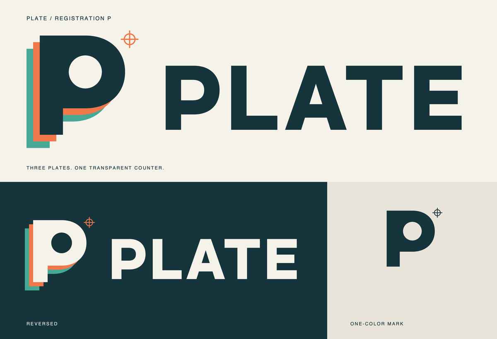

# PLATE — registration P

Three offset printing plates form a P. Teal and vermilion reveal the stack beneath
the ink face; the circular counter passes through all three plates as real
transparency. A registration cross references print alignment and precise geometry.
The wordmark uses original outlined lettering, with no font dependency.



| File | Use |
| --- | --- |
| [plate-logo.svg](plate-logo.svg) / [PNG](plate-logo.png) | Primary transparent lockup; ink lettering for light backgrounds |
| [plate-mark.svg](plate-mark.svg) / [PNG](plate-mark.png) | Square, transparent symbol |
| [plate-logo-reversed.svg](plate-logo-reversed.svg) / [PNG](plate-logo-reversed.png) | Cream face and lettering for dark backgrounds |
| [plate-logo-mono.svg](plate-logo-mono.svg) / [PNG](plate-logo-mono.png) | One-color lockup, simplified to the front P |
| [plate-mark-mono.svg](plate-mark-mono.svg) / [PNG](plate-mark-mono.png) | One-color symbol |

Palette: ink `#16343b`, teal `#45a995`, vermilion `#f0784a`, presentation paper
`#f5f2ea`. Paper is a presentation background, not part of the transparent artwork.
The three plates, registration mark and wordmark have named SVG layers. Illustrator
import behaviour remains subject to the project's existing validation checklist.

## The logo is also a tracing challenge

The primary master is byte-identical to
[`logo_plate.target.svg`](../../samples/challenges/logo_plate.target.svg). Its
[PNG input](../../samples/challenges/logo_plate.png) is rendered at 4× and
downsampled with Lanczos, just like the other independent challenges. The challenge
uses the primary artwork without simplifying it or adding test decorations.

Expected structure: **11 objects**, comprising three complete compound P plates
with circular holes, five letter paths (including P/A counters), and three editable
registration strokes (one circle and two straight paths). The plates must remain
whole behind later plates, with the authored paint order and real transparent
counters. This is a desired authoring contract; a single raster does not uniquely
determine the hidden contours of these arbitrary compound shapes.

Initial default result, 2026-10-30: **11 objects, 125 anchors, 1/3 strokes**;
SSIM **0.9906 white / 0.9956 dark**. The rear plates remain strips: the back plate's
full-silhouette IoU is **0.1387**. The registration cross/ring merge, and some square
corners round off. The full structural contract is a strict expected failure;
integrity and SSIM ≥0.98 on both backgrounds are active tests. Plain VTracer:
333 objects, 824 anchors, white SSIM 0.9337. No pipeline thresholds were changed
to accommodate the identity.

```sh
# Regenerate the identity and its exact tracing fixture from authored geometry.
DYLD_FALLBACK_LIBRARY_PATH=/opt/homebrew/lib .venv/bin/python scripts/make_plate_brand.py

# Trace the real logo and inspect the report.
.venv/bin/plate trace samples/challenges/logo_plate.png -o /tmp/plate-logo.svg --report

# Include the identity in the standard comparison with plain VTracer.
.venv/bin/plate bench samples/challenges -o /tmp/plate-brand-bench
```

`scripts/make_plate_brand.py /tmp/plate-brand-regenerated` regenerates into an
isolated output root. Targets are authored independently; never replace them with
PLATE output. The monochrome variants simplify the stack for small/one-color use
and are not the challenge oracle.
